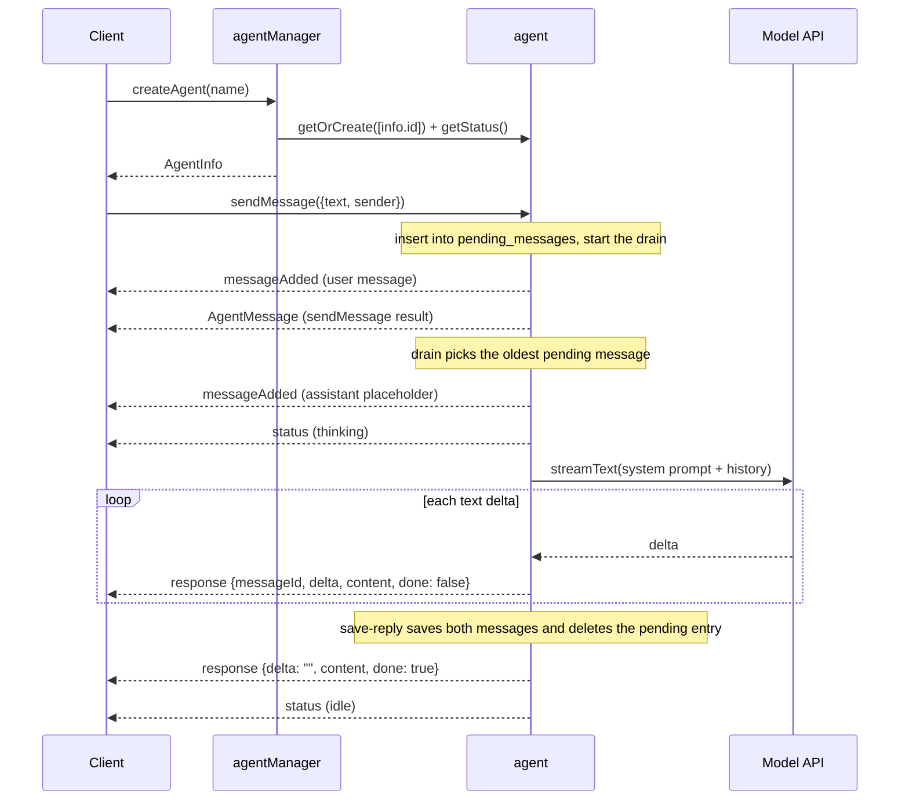

Patterns for building AI agent backends with RivetKit, where each conversation is one Rivet Actor that owns its memory, its pending messages, and its streaming output.

## Starter Code

Start with one of the working examples on [GitHub](https://github.com/rivet-dev/rivet/tree/main/examples/ai-agent) and adapt it. The sections below describe the flagship `ai-agent` example unless a variant is called out explicitly.

| Variant | Starter Code | Use When |
| --- | --- | --- |
| Streaming AI SDK agent | [GitHub](https://github.com/rivet-dev/rivet/tree/main/examples/ai-agent) | You want a streaming chat agent where each conversation keeps its own persistent memory and answers one message at a time, in order. |
| Sandbox coding agent | [GitHub](https://github.com/rivet-dev/rivet/tree/main/examples/sandbox-coding-agent) | The agent should run a coding agent (Codex by default) inside an isolated [sandbox](/agentos/docs) via Docker, Daytona, or E2B. |
| Durable streams agent (experimental) | [GitHub](https://github.com/rivet-dev/rivet/tree/main/examples/experimental-durable-streams-ai-agent) | You want replayable, restart-safe prompt and response delivery through durable streams instead of SQLite and events. |

## Conversation Memory

Use one actor per conversation, keyed by a conversation or agent id (see [Actor Keys](/actors/docs/keys)). The agent actor's embedded [SQLite](/actors/docs/sqlite) database is the conversation memory: in the `ai-agent` example, the `messages` table holds every answered message with its reply, and `pending_messages` holds user messages that are still waiting for a reply. Both survive sleep and restarts with no external database. `status` lives only in `c.vars` because it describes the current run. Every model call rebuilds the prompt from a system prompt, the saved `messages` and the message being answered, so memory and inference input are the same data.

| Variant | Where Memory Lives | Persisted Data |
| --- | --- | --- |
| `ai-agent` | Actor SQLite | `messages`, `pending_messages` |
| `sandbox-coding-agent` | Actor SQLite plus the sandbox ACP session | `messages`, `sessionId` |
| `experimental-durable-streams-ai-agent` | Durable streams; the actor stores only its conversation id and a read cursor in SQLite | `conversationId`, `promptStreamOffset` |

## Message Handling

In the `ai-agent` example, the client calls the agent's `sendMessage` [action](/actors/docs/actions) with `agent.connection.sendMessage({ text, sender })`. The action inserts the message into `pending_messages`, broadcasts it as `messageAdded`, starts a drain and returns the saved message. The message is durable as soon as the insert resolves, before any model call starts.

The drain answers pending messages oldest first, one at a time. Only one drain runs per actor, so each conversation has at most one in-flight model call and replies keep arrival order, even though actions run concurrently. The `status` field (`thinking` while a model call is in flight) is UI signal only; the single drain is the actual lock. The drain runs inside `c.keepAwake`, so the actor does not sleep while a reply is streaming, and `onWake` (see [Lifecycle](/actors/docs/lifecycle)) starts it on every start, so messages left pending by a sleep or crash still get answered.

Every drain runs on the `onWake` context, including the ones `sendMessage` starts. An action's `c.abortSignal` belongs to that call and no longer fires on shutdown once the action returns, so a drain started with it would keep streaming until the shutdown grace deadline. `onWake` stores `c.vars.startDrain`, a function bound to its own context, and `sendMessage` calls it.

When a reply finishes, one named [transaction](/actors/docs/sqlite#transactions), `save-reply`, inserts the user message and the reply into `messages` and deletes the pending entry, so a message is never answered twice in the transcript. The `onWake` context's `c.abortSignal` is passed to `streamText`, so shutdown cancels the model call and the drain stops without saving a partial reply. A crash or shutdown mid-reply leaves the message pending, and the next start answers it again from the beginning.

| Variant | Message Ingress | Serialization Guarantee |
| --- | --- | --- |
| `ai-agent` | `sendMessage` action that saves to `pending_messages` | A single drain answers pending messages in insert order, one model call at a time, and `onWake` resumes it after a restart. |
| `sandbox-coding-agent` | `sendMessage` action that prompts the sandbox directly | Each call awaits the sandbox round trip before broadcasting the result. |
| `experimental-durable-streams-ai-agent` | Durable prompt stream long-polled from `onWake` | `promptStreamOffset` is persisted per chunk, so restarts resume without reprocessing prompts. |

## Streaming Responses

The `ai-agent` actor broadcasts a `response` [event](/actors/docs/events) for every model text delta. The payload carries `messageId`, the per-token `delta`, the cumulative `content`, and a `done` flag (plus `error` on failure), so clients can either append deltas or idempotently replace the message by `messageId` using `content`. The example frontend replaces by `messageId`, which tolerates dropped events. The terminal broadcast has an empty `delta`, the full `content`, and `done: true`.

The reply lives in `c.vars` while it streams and is saved to SQLite with its user message when streaming ends. `getHistory` returns the saved messages, then the pending ones, with the streaming reply and its content so far after the message it answers, so a client that connects mid-stream sees the partial reply and keeps it current from later `response` events. The reply's `messageAdded` event carries `replyTo`, the id of the message it answers, so the example frontend inserts the reply right after that message and the live view matches the `getHistory` order. The example broadcasts once per AI SDK delta with no throttling; batching or throttling deltas is a recommended extension for high-traffic deployments, not something the example implements.

Variant differences: `sandbox-coding-agent` sends a single `response` broadcast with `done: true` after the sandbox finishes (no incremental streaming), and `experimental-durable-streams-ai-agent` appends per-token chunks to a durable response stream, then broadcasts `responseComplete` or `responseError`.

## Architecture

| Topic | Summary |
| --- | --- |
| Topology | `agentManager["primary"]` singleton directory plus one `agent[agentId]` actor per conversation. |
| Ingress | Client calls the agent's `sendMessage` action with an `AgentMessageInput`; the message waits in `pending_messages` until its reply is saved. |
| Streaming | One `response` broadcast per model delta, terminal broadcast with `done: true`. |
| Memory | Transcript and pending messages in the agent's SQLite database, status in `c.vars`; no external database. |

The manager creates `AgentInfo` records and warms each agent through [actor-to-actor communication](/actors/docs/communicating-between-actors): `createAgent` calls `c.client<typeof registry>()`, then `client.agent.getOrCreate([info.id])` and awaits `getStatus()` so the conversation actor exists before the client connects. The sandbox variant extends this topology with a `codingSandbox` actor that shares the agent's key (`codingSandbox.getOrCreate([c.key[0]])`), so the agent-to-sandbox mapping is implicit in the key space.

**Actors**

<AccordionGroup>
<Accordion title='agentManager["primary"]'>

- **Key**: `agentManager["primary"]`
- **Responsibility**: Directory actor. Creates `AgentInfo` records, lists agents, and warms each agent actor via `c.client()`.
- **Actions**
  - `createAgent`
  - `listAgents`
- **SQLite tables**
  - `agents`

</Accordion>
<Accordion title="agent[agentId]">

- **Key**: `agent[agentId]`
- **Responsibility**: One actor per conversation. Holds the full message history and status, saves user messages from `sendMessage` as pending, answers them in order from a drain that runs on the `onWake` context, calls the model via the AI SDK, and broadcasts streaming deltas.
- **Actions**
  - `sendMessage`
  - `getHistory`
  - `getStatus`
- **Lifecycle hooks**
  - `onWake`
- **Events**
  - `messageAdded`
  - `status`
  - `response`
- **SQLite tables**
  - `messages`
  - `pending_messages`
- **Vars**
  - `status`
  - `reply`
  - `pending`
  - `draining`
  - `startDrain`

</Accordion>
</AccordionGroup>

**Lifecycle**

## Security Checklist

The examples ship without auth so they stay minimal. Apply this baseline before exposing an agent backend.

- **API keys stay server-side**: `OPENAI_API_KEY` (or `ANTHROPIC_API_KEY`) is read by the AI SDK inside the actor process. The key never reaches the browser; clients only talk to the actor over RivetKit. The sandbox variant forwards keys into the sandbox env, never to the client.
- **Add authentication**: The examples have no auth, so anyone who reaches the server can create agents, list them, and message any agent whose key they can guess. Add `onBeforeConnect` checks with scoped tokens as a recommended extension. See [Authentication](/actors/docs/authentication).
- **Validate and rate-limit messages**: `sendMessage` only rejects input whose `text` is missing or blank. Enforce payload size limits, schema validation, per-connection rate limits, and a cap on pending messages as a recommended extension.
- **Derive sender identity server-side**: The example trusts the client-supplied `sender` field verbatim. Bind sender identity to the authenticated connection instead.
- **Cap or trim message history**: The example sends the full transcript on every model call with no cap. Trim or summarize old messages as a recommended extension so prompts and stored history stay bounded.
- **Set cost ceilings per conversation**: Add per-agent token budgets and quotas as a recommended extension. The sandbox variant runs real compute, so also enforce per-user sandbox quotas and restrict sandbox network egress.
